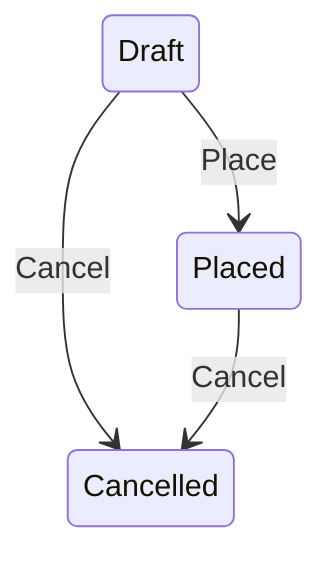

# Domain

`YAF.Domain` holds the building blocks of a domain model: typed ids, entities and aggregate roots, mementos, builders, value objects, smart enumerations, domain events, business rules and policies, specifications and state machines. A service's domain project references `YAF.Domain` and, through it, `YAF.Core`, and nothing else: no ORM, no mediator, no validation library, no logging and no dependency injection.

Three ideas run through the package:

- State leaves and enters an aggregate only through a **memento**, an interface the domain declares and the persistence layer implements.
- A behaviour that can fail returns a <xref:YAF.Core.Results.Result>; it never throws for a business outcome. Errors are declared in catalogues, as the results and errors article describes.
- Nothing in the domain reads a clock, a configuration value or a service. Time and every other ambient value are passed in.

The snippets come from the tests of `YAF.Domain`, which use a small order model: the aggregate `Order` with the child entity `OrderLine`, the status enum `OrderStatus` and the smart enumeration `Channel`.

## Typed ids

Every entity has an id type of its own. Declare it as an empty `readonly partial record struct` with <xref:YAF.Core.Ids.TypedIdAttribute>:

[!code-csharp]

The generator shipped inside `YAF.Core` emits the rest: the <xref:YAF.Core.Ids.ITypedId%601> implementation, `Guid Value`, `New()`, which creates a UUID version 7, `From(Guid)`, `Parse` and `TryParse`, `ToString()` (the guid in format `D`), a `System.Text.Json` converter and a `TypeConverter` for route and query binding. Nothing specific to a store is generated into the domain project.

The domain assigns the id when it creates the entity; there is no id that stays empty until the entity is saved. `default` is not a valid id, and the entity constructor rejects it. One id type serves one entity type. The analyzer `YAF2009` reports a raw `Guid` parameter named `id` or `*Id` on a public or protected member, so that the id of one aggregate cannot be passed where another's is expected.

## Entities and aggregate roots

An aggregate root derives from <xref:YAF.Domain.AggregateRoot%603> and implements <xref:YAF.Domain.IOriginator%602>. The three type parameters are the id, the type itself and its memento interface. A child entity derives from <xref:YAF.Domain.Entity%603>. The `Order` fixture is a complete aggregate, with its memento interface nested in it:

[!code-csharp]

- The constructor is `private`. An aggregate is created through a `static Result<T> Create(...)` factory or a builder, and restored through the static `Restore` of `IOriginator`, which creates the instance and calls `RestoreFrom`.
- There are no public setters. Collections are exposed as `IReadOnlyList<T>` or `IReadOnlyCollection<T>`.
- State changes only through behaviour methods named in the ubiquitous language. A behaviour that can fail returns `Result` or `Result<T>`; one that cannot returns `void`.
- An aggregate references another aggregate by its id only, as `Order` holds a `CustomerId`.
- `CheckInvariants()` states what must hold after every behaviour. Builders call it before they return an aggregate, and tests call it after each behaviour.

The root carries the <xref:YAF.Domain.AggregateVersion> of the whole aggregate, which the persistence layer uses as its concurrency token. Child entities have no version of their own, so two concurrent commands on one aggregate always conflict, even when only a child changed.

A behaviour queues domain events with `Raise`. The aggregate knows no dispatcher, repository or unit of work: the aggregate tracker of the persistence layer collects the queued events through <xref:YAF.Domain.IAggregateRoot>.

[!code-csharp]

A child entity has its id from the aggregate that creates it and lives and dies with it:

[!code-csharp]

### Check first, then mutate

A behaviour evaluates all its rules against the current state and the inputs before any field changes, so a failed behaviour leaves the entity untouched. The protected `Check(params IBusinessRule[])` returns the error of the first broken rule, `CheckAll` the errors of all broken rules in order; both succeed when every rule holds. Chain the change with `Then`, which runs only on success. There is no rollback helper. The test shows that a broken rule leaves the quantity as it was:

[!code-csharp]

## Mementos

A memento interface describes the state of an entity. The domain declares it, nested in the entity, and the service's infrastructure implements it with a data class. `Snapshot` writes the base members (the id and, on a root, the version), then calls `SnapshotCore`, which writes every other member every time. `Restore` reads every member and never validates: stored state is trusted. A memento whose id is not the entity's makes `RestoreFrom` throw <xref:YAF.Domain.Mementos.CorruptStateException>, a sign of a bug or of tampering, whose message carries type names and ids, never values.

The base contracts are in the namespace `YAF.Domain.Mementos`:

| Interface | Members | Filled by |
|---|---|---|
| `IEntityMemento` | `Id` | The domain, in `Snapshot` |
| `IVersionedMemento` | `Version` | The persistence layer, each time it saves the aggregate |
| `ITenantOwnedMemento` | `TenantId` | The persistence layer, from the tenant context |
| `IStampedMemento` | `CreatedAt`, `CreatedBy`, `ModifiedAt`, `ModifiedBy` | The persistence layer |
| `ISoftDeletableMemento` | `DeletedAt`, `DeletedBy` | The persistence layer, on removal |
| `IDataSubjectOwnedMemento` | `DataSubjectId` | The domain |
| `IAggregateMemento` | The first four | |
| `IOwnedEntityMemento` | `Id` and the stamps; no tenant and no version, which the root covers | |

A member of a memento is a primitive, a typed id, a C# `enum`, a smart enumeration, a value object, the nullable form of any of these, or a collection of child mementos. The domain writes its own types: it does not flatten a status to a `string`, an id to a `Guid` or `Money` to two columns. How each is stored is the persistence layer's concern. Every `string`, `byte[]` and free-form member is classified, as `Title` is with `[PublicData]` in the `Order` memento. Mementos carry no behaviour: no encryption, no input checks and no logging. The persistence layer protects classified members from their attributes, and the domain always reads and writes clear values.

### Child collections

Child mementos are matched by id, never by position. <xref:YAF.Domain.Mementos.MementoCollections>`.Sync` reuses the memento of a child that stays, creates one with the factory for a new child and removes the mementos of children that are gone. Mementos that stay keep their order; new ones are appended.

[!code-csharp]

## Builders

When creation takes more than about four inputs or has optional parts, use an <xref:YAF.Domain.AggregateBuilder%601> instead of a `Create` factory. `Build()` calls `Create`, then `CheckInvariants`. When an invariant is broken it returns the errors and raises nothing. Otherwise it calls `OnCreated`, where the builder queues the "created" event through a method of the aggregate, and returns the aggregate.

[!code-csharp]

A builder holds no unmanaged state and is not `IDisposable`.

## Value objects

A value object is an immutable `record` that is equal by value. When construction can fail, it is created through `static Result<T> Create(...)` and validated once, at creation. <xref:YAF.Domain.ValueObject> is an optional marker base that lets architecture tests find value objects. A value object has no id and no tenant, and holds no free text with personal data; such data belongs on an entity, where its memento member is classified.

`YAF.Domain.ValueObjects` ships these, with their errors in <xref:YAF.Domain.ValueObjects.ValueObjectErrors>:

| Type | What it does | Error codes |
|---|---|---|
| <xref:YAF.Domain.ValueObjects.Currency> | An ISO 4217 code that has minor units. `FromCode` is ordinal and case-sensitive | `core.currency.unknown` |
| <xref:YAF.Domain.ValueObjects.Money> | An amount in a currency. `Add` and `Subtract` return a failure for two currencies. `Multiply` does not round; `Round` takes an explicit `MidpointRounding` | `core.money.currency_mismatch` |
| <xref:YAF.Domain.ValueObjects.Percentage> | 0 to 100 inclusive, with `Of(Money)` and `Of(decimal)`, which do not round | `core.percentage.out_of_range` |
| <xref:YAF.Domain.ValueObjects.DateRange> | Two dates, both included. `Contains`, `Overlaps`, `Intersect` | `core.date_range.end_before_start` |
| <xref:YAF.Domain.ValueObjects.Period> | Two instants; the start is included, the end is not. An empty period contains and overlaps nothing | `core.period.end_before_start` |
| <xref:YAF.Domain.ValueObjects.EmailAddress> | A syntax check only, with the domain in lower case. Classified `[PersonalData]` on the type; `ToString()` returns `***`, so a logged instance does not reveal the address | `core.email_address.invalid` |

`Money.Allocate` splits an amount without losing a minor unit. It works in minor units, truncates each share and hands out what is left one minor unit at a time, from the first share on, so the shares always add up to the amount:

[!code-csharp]

Nothing country-specific ships in the framework.

## Smart enumerations

A smart enumeration is a closed set of values that carry data or behaviour. It derives from <xref:YAF.Domain.Enumeration%601> and declares its values as `public static readonly` fields:

[!code-csharp]

`Code` is stable: it is what is stored and serialized. `Name` is for display. `All` lists the values in declaration order. `FromCode` compares ordinally and returns a `Result`, which fails with `core.enumeration.unknown_code` (<xref:YAF.Domain.DomainErrors>) for an unknown code. Use a plain C# `enum` when the values carry nothing.

<xref:YAF.Domain.EnumerationJsonConverterFactory> converts every smart enumeration to and from JSON by its code. Register it in the serializer options:

[!code-csharp]

or name it on the type with `[JsonConverter(typeof(EnumerationJsonConverterFactory))]`. `System.Text.Json` does not read the attribute from a base type, so `Enumeration<TSelf>` cannot attach it for you. An unknown code throws a `JsonException` whose message does not repeat the value.

## Domain events

A domain event is an immutable record named in the past tense. It derives from <xref:YAF.Domain.Events.DomainEvent> and carries ids and the facts a handler needs, never the aggregate itself:

[!code-csharp]

`EventId` is a new UUID version 7. `OccurredAt` stays `default` until the persistence layer stamps it, from its `TimeProvider`, when it collects the event. Events are raised inside the behaviour that causes them and dispatched in the same transaction, after the changes are flushed and before the commit. An event carries no personal data unless a handler in the same bounded context needs it.

## Business rules and policies

A business rule is a small, pure class that implements <xref:YAF.Domain.Rules.IBusinessRule>. It is constructed with the values it needs and names the error it reports:

[!code-csharp]

A behaviour checks rules with `Check` or `CheckAll`, as shown in [Check first, then mutate](#check-first-then-mutate). Guards that need aggregate data are rules, never lambdas inside a state machine definition.

A policy is a decision that varies by tenant, time or configuration: <xref:YAF.Domain.Rules.IPolicy%602> with `Decide(input)`. The domain declares the interface and a default implementation; the application layer chooses which one runs.

[!code-csharp]

Logic that spans aggregates and holds no state goes in a domain service, which takes aggregates or values as arguments and loads nothing itself.

## Specifications

A specification is a named condition that can check an object in memory and filter a query in the store. It derives from <xref:YAF.Domain.Specifications.Specification%601> and returns an expression:

[!code-csharp]

- `T` is normally the aggregate's memento interface, the description of the state that the store can query. Its members are typed, so a specification compares a status with the enum value and an id with a typed id, never with a string. A specification over the aggregate itself is fine for rules that run only in memory.
- `IsSatisfiedBy` compiles the expression on first use and keeps the delegate. Because it compiles expressions at run time, `YAF.Domain` is not marked AOT-compatible.
- `And`, `Or` and `Not` combine specifications into one with a single parameter, so a store sees an ordinary lambda.
- A specification holds values, not services. Time is passed in.

Use one when the same predicate is needed both to check and to query, or when it has a name in the ubiquitous language. A one-off query filter does not need one.

## State machines

A <xref:YAF.Domain.StateMachines.StateMachine%602> declares the allowed transitions of a status. The definition is a static field, immutable and free of side effects:

[!code-csharp]

- `From`, `On` and `To` come in that order, once per transition. A call out of order, a second target for the same state and trigger, or `Otherwise` after an unfinished transition throws `InvalidOperationException` naming the state. Because the definition is a static field, the mistake shows the first time the type is used.
- `Fire(current, trigger)` returns `Result<TState>`: the target state, or the `Otherwise` error filled with the arguments `From` and `Trigger`. The behaviour assigns the state and raises the event.
- `PermittedTriggers(current)` lists the triggers defined for a state, in definition order, for responses that tell a client what it may do next.
- `States` lists every state the definition names, in order of first appearance.

`ToMermaid()` renders the definition as a Mermaid state diagram, one line per transition in definition order:

[!code-csharp]

For the order lifecycle above, that is this diagram:

## Rules

1. Ids are typed ids, created by the domain with `New()` when the entity is created. No raw `Guid` named `*Id` on a public member (`YAF2009`).
2. Aggregate constructors are `private` or `internal`. Creation goes through a `Create` factory or an `AggregateBuilder<T>`, both returning `Result<T>`.
3. No public setters. Collections are exposed read-only.
4. State changes only through behaviour methods. A behaviour checks first, then mutates, and returns `Result` when it can fail; it never throws for a business outcome.
5. Every behaviour leaves the aggregate satisfying `CheckInvariants()`.
6. Aggregates reference other aggregates by id only.
7. The aggregate queues events with `Raise` and knows no dispatcher, repository or unit of work. Events carry ids and facts, never the aggregate.
8. The memento interface is nested in its entity. `Snapshot` writes every member; `Restore` reads every member and never validates. Members keep their domain types.
9. Child mementos are matched by id with `MementoCollections.Sync`.
10. Mementos carry no behaviour. Every `string`, `byte[]` and free-form member is classified.
11. No static or ambient state: nothing in the domain reads `TimeProvider`, configuration or a service.
12. Value objects are immutable records without id, tenant or free text holding personal data.
13. State machine definitions are static and free of side effects; guards that need aggregate data are business rules.
14. Every error is declared in an error catalogue.

## Configuration

`YAF.Domain` has no options and no configuration keys. The one piece of setup is JSON: register <xref:YAF.Domain.EnumerationJsonConverterFactory> in the serializer options of every place that reads or writes smart enumerations, or name it on each smart enumeration type.

## Testing it

- Test each behaviour's outcome: the state after it, the event it raised and, on a failure, the error **code**. Assert on codes, never on messages.
- Test a failed behaviour too, and check that it left the state as it was.
- Test each business rule on its own, with the values it is constructed with.
- Every aggregate has a memento round-trip test: snapshot, restore, snapshot again, and compare. `MementoAssert.RoundTrips` in `YAF.Testing` does this with any memento factory and reports the path of the first member that differs. Set a member of every type the memento has, and repeat the test with the nullable members `null`:

[!code-csharp]

- Test child collections through a memento that was used before: a child added, one kept and one removed.
- Call `AggregateAssert.InvariantsHold` after each behaviour, and use `DomainEventAssert.Raised<TEvent>` to read a queued event.
- Test a state machine's transitions through `Fire`, including a trigger that is not allowed, and its diagram through `ToMermaid`.
- Domain tests are plain unit tests: they need no host, no container and no clock. Pass a fixed time where a behaviour takes one.
